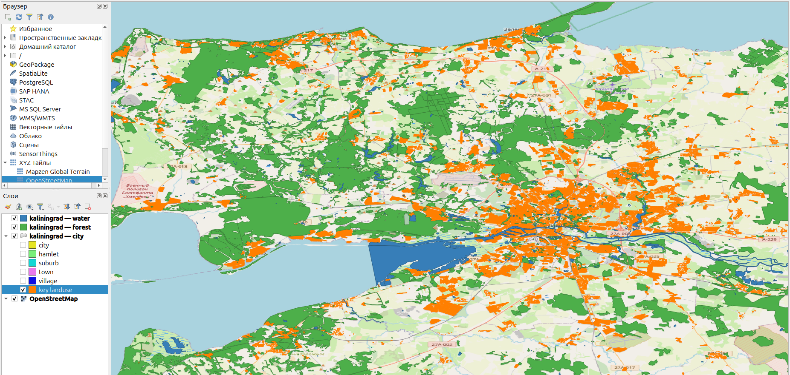
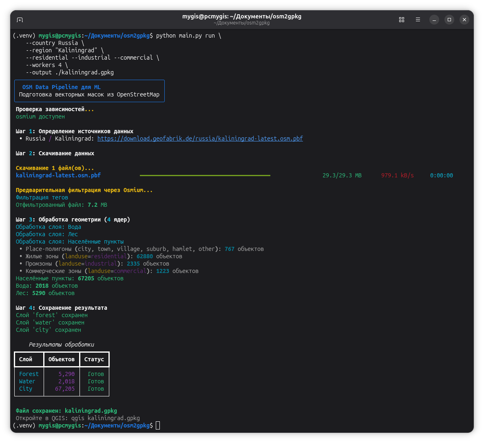
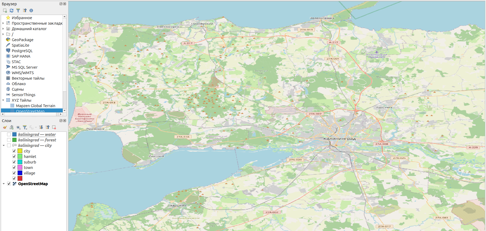
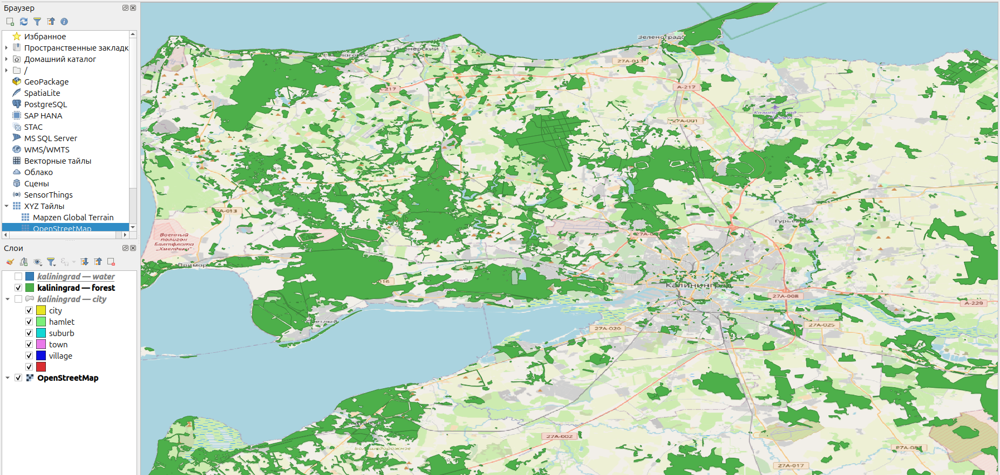
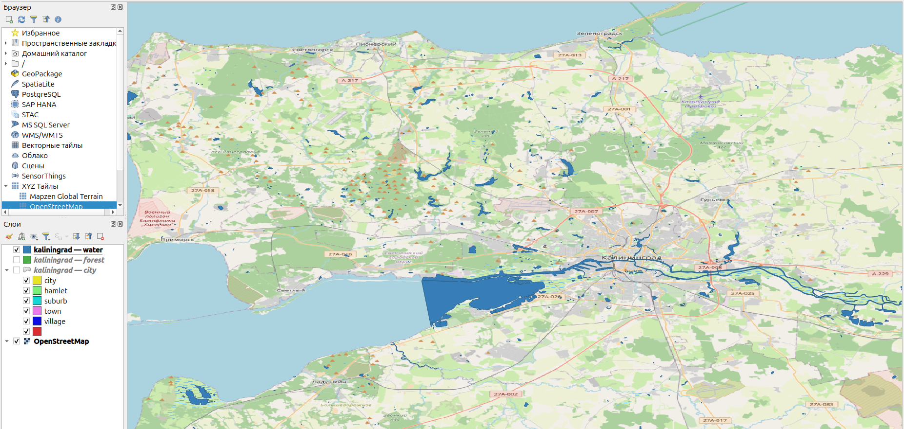
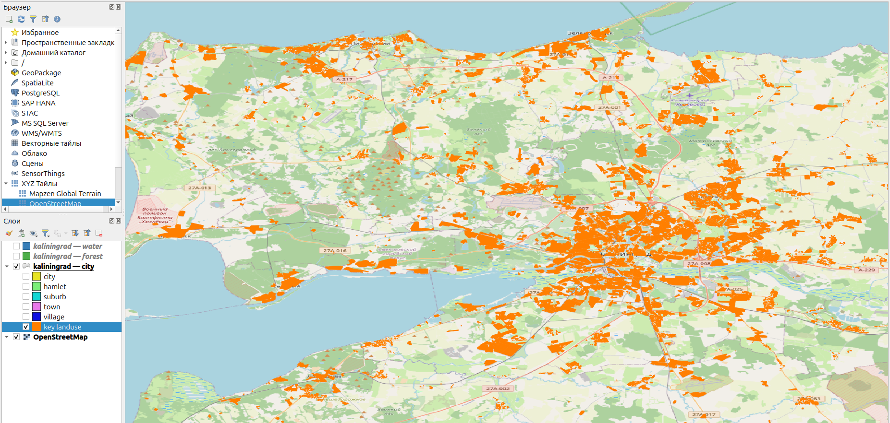
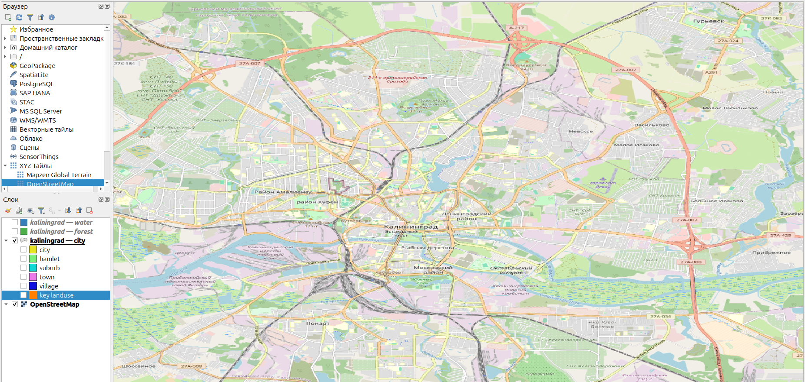
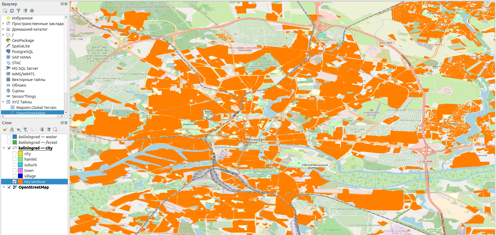

# 🗺️ OSM Data Pipeline для ML

*CLI-приложение для автоматизированной подготовки векторных масок из OpenStreetMap для обучения моделей машинного обучения на спутниковых снимках.*



---

## 📋 Содержание

- [О проекте](#-о-проекте)
- [Возможности](#-возможности)
- [Архитектура](#-архитектура)
- [Требования](#-требования)
- [Установка](#-установка)
- [Использование](#-использование)
- [Параметры командной строки](#-параметры-командной-строки)
- [Выходные данные](#-выходные-данные)
- [Структура Geofabrik](#-структура-geofabrik)
- [Структура проекта](#-структура-проекта)
- [Устранение неполадок](#-устранение-неполадок)
- [Лицензия](#-лицензия)

---



## 🎯 О проекте

**OSM Data Pipeline** — это высокопроизводительное консольное приложение, которое автоматизирует полный цикл подготовки обучающих данных из OpenStreetMap:

1. **Скачивание** актуальных `.osm.pbf` файлов с Geofabrik
2. **Фильтрация** только нужных объектов (лес, вода, города)
3. **Обработка геометрии** с учётом минимальных площадей и ширины русел
4. **Экспорт** в многослойный GeoPackage, готовый для QGIS

Результат идеально подходит для подготовки масок при обучении моделей семантической сегментации на спутниковых снимках высокого разрешения.

---

## ✨ Возможности

| Функция | Описание |
|---------|----------|
| 🌍 **Гибкая география** | Скачивание по странам, регионам или bounding box |
| ⚡ **Параллельная загрузка** | Многопоточное скачивание через `ThreadPoolExecutor` |
| 🔄 **Автоматические повторы** | До 5 retry с экспоненциальной задержкой (1→16 с) при сетевых сбоях; 4xx (404) падает сразу |
| 🧹 **Дедупликация URL** | Несколько регионов, указывающих на один файл, скачиваются один раз |
| 🚀 **Многопроцессорная обработка** | Распараллеливание CPU-задач через `ProcessPoolExecutor` |
| 🌲 **Умная фильтрация леса** | Полигоны площадью ≥ 2500 м² (0.25 га) |
| 💧 **Обработка воды** | Полигоны + буферизация рек шириной ≥ 25 м |
| 🏙️ **Административные границы** | Настраиваемые уровни `admin_level` для городов |
| 📊 **Красивый UI** | Прогресс-бары и таблицы через `Rich` |
| 💾 **GeoPackage** | Единый файл с тремя слоями, открывается в QGIS |

---

## 🏗️ Архитектура

```
┌─────────────────────────────────────────────────────────────┐
│                      CLI (Typer + Rich)                     │
└──────────────────────────┬──────────────────────────────────┘
                           │
              ┌────────────▼────────────┐
              │   Георафия и параметры  │
              └────────────┬────────────┘
                           │
         ┌─────────────────▼─────────────────┐
         │     ThreadPoolExecutor (I/O)      │
         │   Параллельное скачивание PBF     │
         └─────────────────┬─────────────────┘
                           │
         ┌─────────────────▼─────────────────┐
         │      osmium merge + extract       │
         │   Объединение и вырезание bbox    │
         └─────────────────┬─────────────────┘
                           │
         ┌─────────────────▼─────────────────┐
         │       osmium tags-filter          │
         │   Предварительная фильтрация      │
         └─────────────────┬─────────────────┘
                           │
    ┌──────────────────────┼──────────────────────┐
    │                      │                      │
┌───▼────┐          ┌──────▼──────┐        ┌──────▼──────┐
│  Лес   │          │    Вода     │        │   Города    │
│(Лес ≥  │          │(Полигоны +  │        │(Админ гран, │
│2500 м²)│          │ Реки ≥25м)  │        │ землипольз.)│
└───┬────┘          └──────┬──────┘        └──────┬──────┘
    │                      │                      │
    └──────────────────────┼──────────────────────┘
                           │
              ┌────────────▼────────────┐
              │  ProcessPoolExecutor    │
              │  (CPU-bound обработка)  │
              └────────────┬────────────┘
                           │
              ┌────────────▼────────────┐
              │   Экспорт в GeoPackage  │
              │      (три слоя)         │
              └─────────────────────────┘
```

### Технологический стек

| Компонент | Технология | Назначение |
|-----------|------------|------------|
| CLI | `Typer` | Командный интерфейс |
| Прогресс | `Rich` | Красивый вывод в терминал |
| Сеть | `requests` + `ThreadPoolExecutor` | Параллельная загрузка + retry |
| Внешние утилиты | `osmium` | Быстрая фильтрация PBF |
| Геоданные | `GeoPandas`, `Pyrosm`, `Shapely` | Обработка геометрии |
| Многопроцессорность | `ProcessPoolExecutor` | CPU-bound задачи |

---

## 📦 Требования

### Системные зависимости

- **OS**: Linux (рекомендуется), macOS
- **Python**: 3.10+
- **osmium**: обязательная внешняя утилита

### Установка системных пакетов

```bash
# Ubuntu/Debian
sudo apt update
sudo apt install python3-venv python3-pip osmium-tool

# macOS (через Homebrew)
brew install python osmium-tool

# Arch Linux
sudo pacman -S python python-pip osmium-tool
```

---

## 🚀 Установка

### 1. Клонируйте репозиторий

```bash
git clone https://github.com/your-username/osm2gpkg.git
cd osm2gpkg
```

### 2. Создайте виртуальное окружение

```bash
python3 -m venv .venv
source .venv/bin/activate
```

### 3. Установите зависимости

```bash
pip install --upgrade pip
pip install -r requirements.txt
```

### 4. Проверьте установку

```bash
python main.py --help
```

Если всё установлено корректно, вы увидите справку по доступным командам.

---

## 📖 Использование

### Базовый запуск

```bash
# Скачать всю Россию
python main.py run

# Скачать несколько стран
python main.py run --country Russia --country Germany

# Указать выходной файл
python main.py run --country Russia --output ./data/russia.gpkg
```

### Работа с регионами

```bash
# Конкретные регионы внутри страны
python main.py run \
    --country Russia \
    --region "Tula Oblast" \
    --region "Moscow" \
    --output ./central_russia.gpkg

# Увеличить число ядер для обработки (по умолчанию 4)
python main.py run \
    --country Russia \
    --region "Kaliningrad" \
    --workers 8 \
    --output ./kaliningrad.gpkg
```

> **ℹ️ Важно:**
>
> - `--region "Moscow"` и `--region "Tula Oblast"` дают один и тот же файл всего ЦФО (~1,5 ГБ). Скрипт автоматически дедуплицирует URL, скачивая файл один раз.
> - Если нужен именно город Москва, скачайте ЦФО и вырежьте bbox:
>
> ```bash
> python main.py run \
>     --country Russia \
>     --region "Moscow" \
>     --bbox "37.3,55.5,37.7,55.9" \
>     --output ./moscow.gpkg
> ```

### Использование Bounding Box

```bash
# Вырезать область по координатам
python main.py run \
    --country Russia \
    --bbox "37.0,55.0,38.0,56.0" \
    --output ./moscow_area.gpkg
```

> **Формат bbox**: `min_lon,min_lat,max_lon,max_lat`

### Точные границы населённых пунктов

> **ℹ️ Важно:**
>
> **Слой `city` содержит точные границы населённых пунктов** (черта города/деревни/посёлка) из двух источников:
>
> 1. **Административные границы** `admin_level` (по умолчанию `10` — черта НП; `8` — поселения/городские округа, бывают крупнее)
> 2. **Place-полигоны** `place=city`, `town`, `village`, `suburb`, `hamlet`, `other` (по умолчанию все включены)
>
> 3. В РФ официальные административные границы (`boundary=administrative`) городских округов или поселений часто включают в себя огромные незастроенные территории — поля, леса и болота, окружающие город. Для обучения моделей на спутниковых снимках административная черта даст слишком много ложноположительных результатов (модель будет учиться «искать город там, где стоит тайга»). 
> Поэтому опционально — можно включить жилые зоны `landuse=residential` флагом `--residential` (реальный контур жилой застройки).
> Тоже можно отнести и к флагам `landuse=industrial` + `landuse=commercial` (заводы и ТЦ, которые со спутника тоже выглядят как городская ткань).

```bash
# Точные границы НП по умолчанию (admin_level=10 + все place-полигоны)
python main.py run \
    --country Russia \
    --region "Kaliningrad" \
    --workers 4 \
    --output ./kaliningrad.gpkg

# Уровни 8+10 и только города с посёлками
python main.py run \
    --country Russia \
    --region "Kaliningrad" \
    --admin-level 8 --admin-level 10 \
    --place-type city --place-type town \
    --output ./kaliningrad.gpkg

# С жилыми зонами landuse=residential (третий источник)
python main.py run \
    --country Russia \
    --region "Kaliningrad" \
    --residential \
    --output ./kaliningrad.gpkg

# С жилыми, промышленными и коммерческими зонами
python main.py run \
    --country Russia \
    --region "Kaliningrad" \
    --residential --industrial --commercial \
    --output ./kaliningrad.gpkg
```













### Полезные команды

```bash
# Показать список доступных стран и регионов
python main.py list-countries

# Показать версию
python main.py version

# Оставить временные файлы для отладки
python main.py run --country Russia --keep-temp
```

---

## ⚙️ Параметры командной строки

| Параметр | Короткий | Тип | По умолчанию | Описание |
|----------|----------|-----|--------------|----------|
| `--country` | `-c` | `list[str]` | `["russia"]` | Названия стран |
| `--region` | `-r` | `list[str]` | `None` | Названия регионов |
| `--bbox` | `-b` | `str` | `None` | Bounding box |
| `--output` | `-o` | `Path` | `./dataset.gpkg` | Путь к выходному файлу |
| `--workers` | `-w` | `int` | `4` | Число ядер CPU |
| `--admin-level` | — | `list[int]` | `[10]` | Уровни админ. границ НП (10 — черта НП; 8 — поселения) |
| `--place-type` | — | `list[str]` | все | Типы place-полигонов (city, town, village, suburb, hamlet, other) |
| `--residential` / `--no-residential` | — | `bool` | `False` | Добавить жилые зоны `landuse=residential` |
| `--industrial` / `--no-industrial` | — | `bool` | `False` | Добавить промзоны `landuse=industrial` |
| `--commercial` / `--no-commercial` | — | `bool` | `False` | Добавить коммерческие зоны `landuse=commercial` |
| `--keep-temp` | — | `bool` | `False` | Сохранить временные файлы |

---

## 📊 Выходные данные

Скрипт создаёт один файл **GeoPackage** (`.gpkg`) с тремя слоями:

| Слой | Тип геометрии | Критерии фильтрации |
|------|---------------|---------------------|
| `forest` | Полигоны | Площадь ≥ 2500 м² |
| `water` | Полигоны | Площадь ≥ 2500 м² + реки шириной ≥ 25 м |
| `city` | Полигоны | Точные границы НП: `admin_level=10` + place-полигоны (настраивается через CLI; опционально `landuse=residential`, `industrial`, `commercial`) |

### Открытие в QGIS

```bash
# Открыть результат в QGIS
qgis ./dataset.gpkg
```

Или через меню: **Слой → Добавить слой → Добавить слой GeoPackage**

---

## 🗂️ Структура Geofabrik

Актуальная раскладка каталогов (октябрь 2026):

```
download.geofabrik.de/
├── russia/                          # Россия — в корне
│   ├── russia-latest.osm.pbf        # вся страна
│   ├── central-fed-district-latest.osm.pbf      # ЦФО (Тверь, Тула, Калуга, …)
│   ├── northwestern-fed-district-latest.osm.pbf # СЗФО
│   ├── crimean-fed-district-latest.osm.pbf      # СКФО
│   ├── siberian-fed-district-latest.osm.pbf     # СФО
│   ├── ural-fed-district-latest.osm.pbf         # УФО
│   ├── far-eastern-fed-district-latest.osm.pbf  # ДФО
│   ├── south-fed-district-latest.osm.pbf        # ЮФО
│   ├── volga-fed-district-latest.osm.pbf        # ПФО
│   ├── kaliningrad-latest.osm.pbf               # Калининград
│   └── …                              # датированные копии + -updates/
└── europe/germany-latest.osm.pbf    # остальные страны
```

Пути регионов и стран в `main.py`: `COUNTRY_PATHS` и `REGION_PATHS` — при 404 на Geofabrik проверьте, не сменилась ли структура каталогов (проверить легко: `curl -sI https://download.geofabrik.de/russia/`).

---

## 📁 Структура проекта

```
osm2gpkg/
├── main.py              # Главный скрипт приложения
├── requirements.txt     # Зависимости Python
├── README.md           # Этот файл
├── .venv/              # Виртуальное окружение
├── data/               # Выходные GeoPackage файлы
│   ├── russia.gpkg
│   └── moscow_area.gpkg
└── temp/               # Временные файлы (если --keep-temp)
```

## 📈 Производительность

| Размер области | Время обработки | Потребление RAM |
|----------------|-----------------|-----------------|
| Небольшой город (~100 км²) | ~2-3 мин | ~2 ГБ |
| Область (~10 000 км²) | ~10-15 мин | ~8 ГБ |
| Страна целиком (Россия) | ~40-60 мин | ~32 ГБ |

> **Совет**: Для больших территорий используйте `--workers` с числом, равным количеству ядер вашего процессора.

---

## 🛠️ Устранение неполадок

| Симптом | Причина | Решение |
|---------|---------|---------|
| `HTTP 404` на Geofabrik | Структура каталогов изменилась | Сверьте путь с [разделом «Структура Geofabrik»](#-структура-geofabrik) и обновите `COUNTRY_PATHS` / `REGION_PATHS` в `main.py` |
| `ReadTimeout` → 5 retry → ошибка | Нестабильный интернет, Geofabrik отдаёт файл медленно | Повторы уже встроены. Если и они не помогают — проверьте сеть, попробуйте в другое время, или скачайте файл вручную через `wget -c` (подхватывает с места обрыва) и положите в ту же папку |
| `⚠ Регион '...' не найден, используется вся страна` | Название региона не в `REGION_PATHS` | Проверьте точное написание: `python main.py list-countries` |
| `osmium не найден в PATH` | Не установлена утилита | `sudo apt install osmium-tool` (Linux) или `brew install osmium-tool` (macOS) |
| `MemoryError` при обработке | Не хватает RAM для большой области | Уменьшите `--workers` или скачивайте по bbox |

> **Проверка доступности файла на Geofabrik** (быстро, без скачивания):
>
> ```bash
> curl -sI https://download.geofabrik.de/russia/central-fed-district-latest.osm.pbf | head -5
> # 200 / 307 — файл существует, 404 — путь неправильный
> ```

---

## 🤝 Вклад в проект

1. Форкните репозиторий
2. Создайте ветку для новой функции (`git checkout -b feature/amazing-feature`)
3. Закоммитьте изменения (`git commit -m 'Add amazing feature'`)
4. Запушьте в ветку (`git push origin feature/amazing-feature`)
5. Откройте Pull Request

---

## 📄 Лицензия

Этот проект распространяется под лицензией **MIT**. См. файл [LICENSE](LICENSE) для подробностей.

Данные получены из [OpenStreetMap](https://www.openstreetmap.org/) и доступны под лицензией [ODbL](https://opendatacommons.org/licenses/odbl/).

---

## 🙏 Благодарности

- [OpenStreetMap](https://www.openstreetmap.org/) — за бесплатные геоданные
- [Geofabrik](https://download.geofabrik.de/) — за хостинг выгрузок
- [Pyrosm](https://pyrosm.readthedocs.io/) — за быстрый парсинг OSM
- [GeoPandas](https://geopandas.org/) — за мощную геобработку

---

## 📞 Поддержка

Если у вас возникли вопросы или проблемы:

1. Проверьте раздел [Устранение неполадок](#-устранение-неполадок)
2. Создайте [Issue](https://github.com/your-username/osm2gpkg/issues) на GitHub
3. Приложите вывод ошибки и команду запуска

---

<div align="center">

**Сделано с ❤️ для сообщества геоинформатики и машинного обучения**

</div>